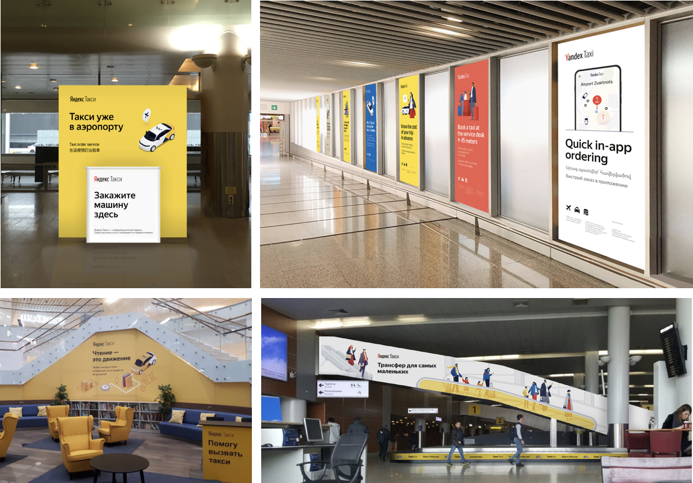
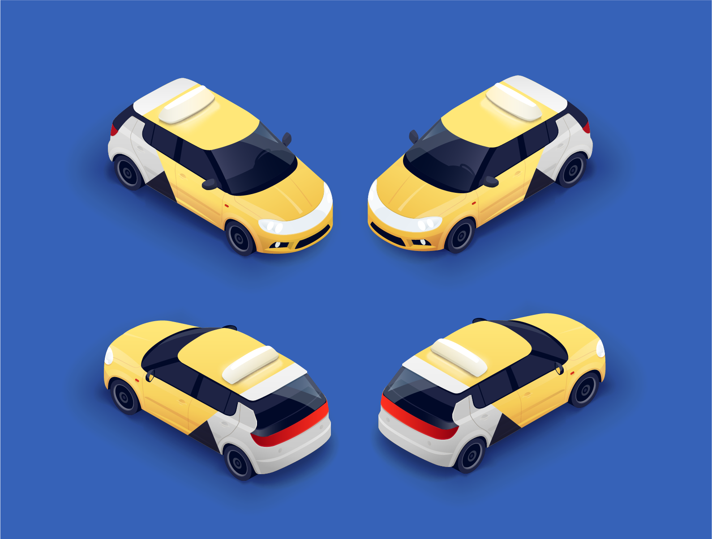
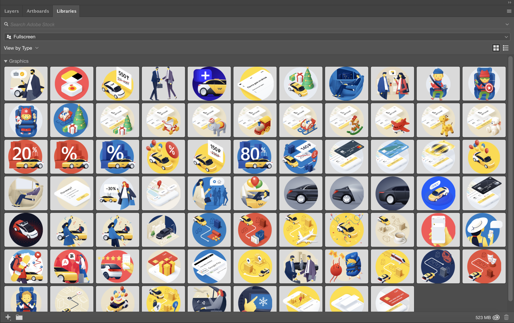
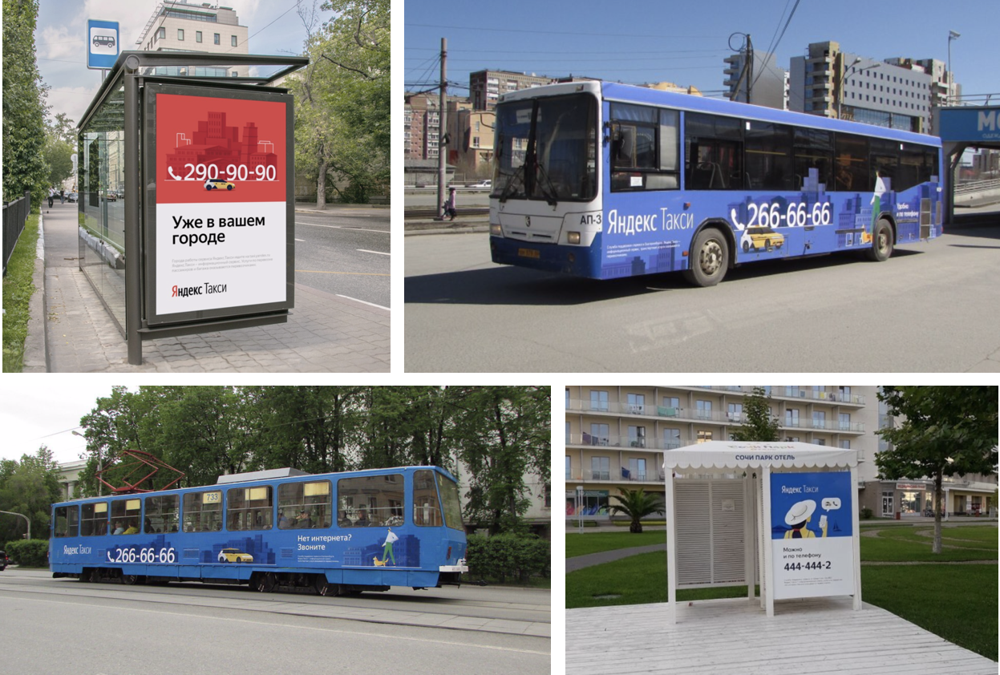

---

# Стиль иллюстраций для Я-Такси

Этот стиль стал для меня ключевой точкой, которая позволила мне исправить ошибки при работе с стилем в основном Яндексе (глобальный). Моя задача была сделать что-то более современное, в то время был бум 2D иллюстрации, отстроиться от конкурентов.

В тот период 3d для меня остается скорее мечтой, рендер в те года был дорогим удовольствием в жилезе, хотя сейчас стало лучше, но всё равно это требует не малой вычеслительной мощности. Вначале я пробовала делать подходы в Cinema 4D, но со времинем поняла, что это сложно массштабировать и столько подрядчиков мы не найдем, а если и найдем, то за большие деньги. Да и признаться честно, тогда я чувствовала себя более уверенно в векторе, и моделировать что-то я скорее неумела. Удивительно смотреть на это из сегодняшнего момента, когда теперь есть в доступе Blender и ребят кто пошёл покорять этот мир стало кратно больше.

Спустя много лет, с любовью и теплом смотрю на проделанную работу, я сделала много ошибок, но каждая подарила мне шанс двигаться дальше.

---

:::gallery

:::

<video autoplay muted loop playsinline>
  <source src="/projects/2d-2/FB-cover-5-rus.mp4" type="video/mp4" />
</video>

::::wrapper

## Работа с объёмом

Моя задача была как можно понятнее передать опыт воссоздания объема в Adobe Illustrator для других иллюстраторов внутри компании и для сторонних оутсорс команд. Были зафиксированны правила и основы, что со временим позволило наростить библиотеку.

:::gallery

:::

:::gallery

:::

::::

## Пространство

:::gallery

:::

:::gallery

:::

:::gallery

:::

## Линия

:::gallery

:::

:::gallery

:::

## Персонажи

<video autoplay muted loop playsinline>
  <source src="/projects/2d-2/Final -FB.mp4" type="video/mp4" />
</video>

## Объекты

:::gallery

:::

:::gallery

:::

:::gallery

:::

:::gallery

:::

:::gallery

:::

Над проектом также рабол Никита Стебеняев, он активно работал над расширением библиотеки.

Анимации были сделаны мной в After Effect
